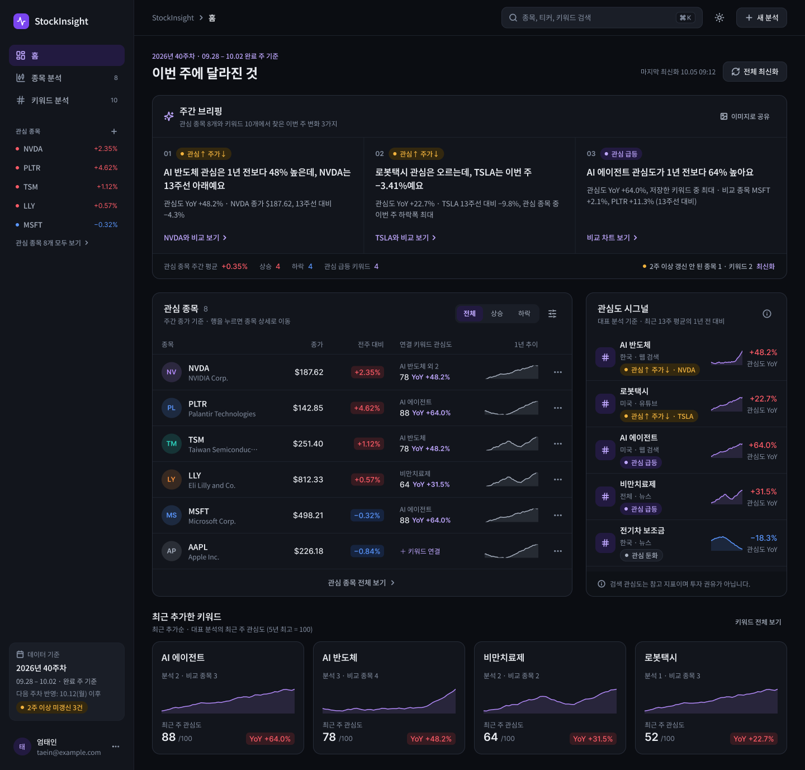
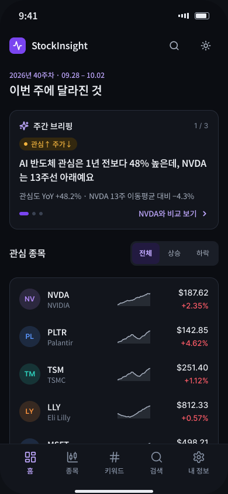
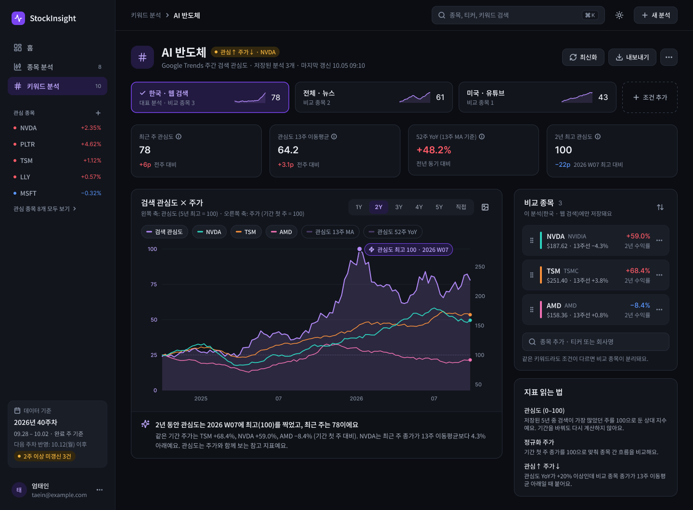
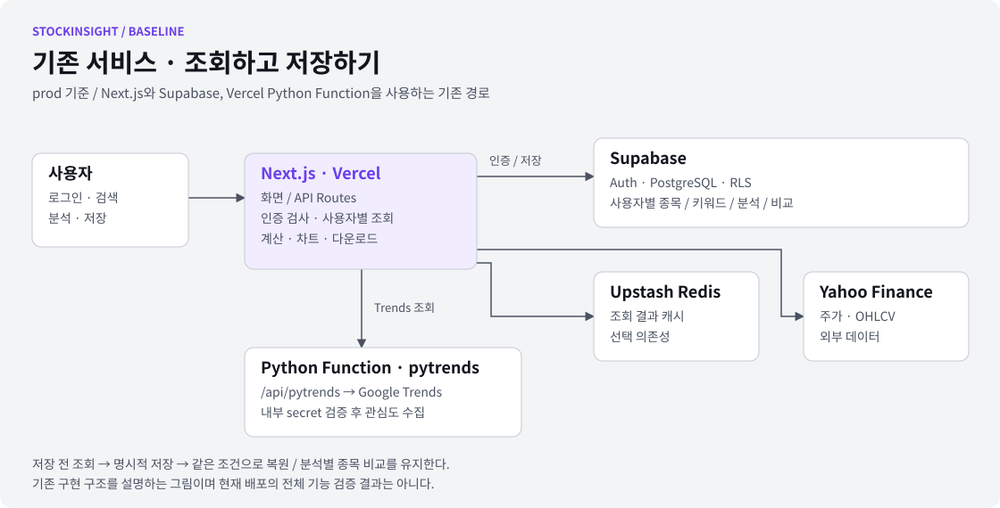
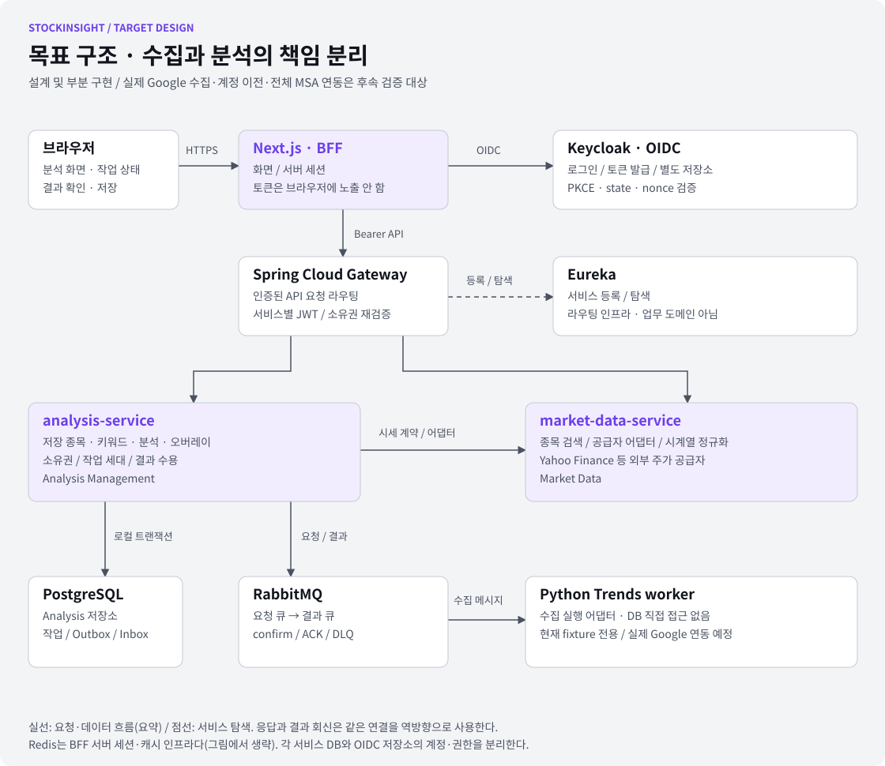

# StockInsight

**검색 관심도와 주가를 같은 시간축에서 비교하고, 저장한 분석을 다시 이어 보는 서비스.**

기존 요구사항을 바탕으로 종목·키워드 분석과 사용자별 저장 기능을 구현했습니다.
현재는 이 기반을 유지하면서 **페르소나 중심의 화면 리뉴얼과 서비스 구조 개편**을 진행하고 있습니다.

[기존 서비스 열기](https://stock-insight-xi.vercel.app/) · [Figma 디자인](https://www.figma.com/design/WEmeHbbzBqEfBxez9dMk9o) · [요구사항](./docs/PRD.md) · [고도화 상세](./docs/RENEWAL.md)

> **버전 안내** — 데모는 `prod`의 기존 Next.js·Supabase·Vercel 버전입니다(로그인 필요).
> 이 README는 `develop`의 리뉴얼 방향도 함께 설명합니다. 아래 Figma 화면과 목표 구조가 모두 데모에 반영된 것은 아닙니다.

[기존 구현](#기존-요구사항으로-구현한-것) · [사용자와 디자인](#누구를-위해-고도화하나요) · [구조 개편](#구조는-왜-어떻게-바꾸나요) · [진행 상태](#어디까지-진행했나요) · [실행 방법](#로컬-실행과-검증)

## 어떤 문제에서 출발했나요?

테마나 브랜드의 검색 관심도와 종목 가격을 비교하려면 Google Trends와 주가 사이트를 번갈아 열고,
날짜와 분석 조건을 직접 맞춰야 합니다. 다음 주에 같은 분석을 이어 보려면 무엇을 비교했는지도 다시 찾아야 합니다.

StockInsight는 **조회 → 비교 → 저장 → 같은 조건으로 다시 확인**하는 흐름을 한곳에 모았습니다.
검색 관심도는 상대 지표이며, 함께 움직인 과거 흐름이 미래 수익이나 인과관계를 보장하지 않습니다.
투자 추천·자동 매매·실시간 시세 서비스는 제품 범위에 포함하지 않습니다.

## 기존 요구사항으로 구현한 것

| 사용자 흐름        | 기존 구현                                                | 지켜야 할 조건                        |
| ------------------ | -------------------------------------------------------- | ------------------------------------- |
| 종목 검색·분석     | 티커/회사명 검색, 5년 주간 OHLCV, 13주 이동평균·52주 YoY | 저장 전 조회와 저장 후 상세를 구분    |
| 키워드 분석        | Google Trends 조회, 지역·검색 유형별 분석 저장           | 이름이 같아도 조건이 다르면 별도 분석 |
| 키워드 × 종목 비교 | 분석별 종목 오버레이, 정규화 가격 비교, 정렬·삭제·최신화 | 비교 종목은 해당 분석에만 속함        |
| 반복 사용          | 저장 목록, 상세·표·커스텀 차트, Excel·PNG 내보내기       | 화면별 내보내기 범위와 기준을 명시    |
| 접근 제어·운영     | Supabase Auth, 사용자별 RLS, 읽기 전용 관리자 화면       | 사용자 데이터 격리와 관리자 접근 제한 |

기존 기술은 **Next.js 15 · React 19 · TypeScript · Tailwind CSS v4 · shadcn/ui · Recharts**,
**Supabase Auth/PostgreSQL**, **Upstash Redis REST**, **Yahoo Finance · pytrends**입니다.
구현 범위는 [PRD](./docs/PRD.md), 기존 API·데이터 흐름은 [TRD](./docs/TRD.md)에 정리했습니다.
위 표는 구현 기능 설명이며 현재 배포의 모든 기능을 재검증했다는 의미는 아닙니다.

## 누구를 위해 고도화하나요?

Figma의 초기 페르소나 **한지우**는 “매주 두 사이트의 데이터를 맞춰 비교하고, 기준 날짜가 있는 차트를 공유하는 사용자”였습니다.
이 문제를 더 구체적으로 나누어, 최신 [페르소나 문서](./docs/PERSONAS.md)는 다음 네 관점으로 확장했습니다.
페르소나는 설계 가정이며 실제 사용자 조사 결과나 성과 지표로 제시하지 않습니다.

| 관점                            | 사용자가 원하는 것                           | 고도화 방향                                                          |
| ------------------------------- | -------------------------------------------- | -------------------------------------------------------------------- |
| **정민서 · 직장인 테마 투자자** | “이번 주 내 관심 대상에 뭐가 달라졌지?”      | PC에서 비교·분석, 모바일에서 빠른 확인. 저장한 분석을 이어 보는 흐름 |
| **박준호 · 리서치 실무자**      | “이 비교를 설명할 근거가 있나?”              | 기간 직접 입력, 출처·기준 날짜, 지표와 내보내기 범위 명시            |
| **김소연 · 입문 투자자**        | “무엇부터 봐야 하고, 이 숫자는 무슨 뜻이지?” | 쉬운 문장, 첫 방문 안내, 요약에서 상세 근거로 이동                   |
| **엄태인 · 1인 개발·운영자**    | “장애와 비용을 혼자 감당할 수 있나?”         | 수집 작업 상태·실패 원인 분리, 복구 가능한 처리, 운영 관측 기반 마련 |

자동 갱신·주간 요약 메일·관계 탐색 등 페르소나의 기대 기능은 **후속 구상**입니다.
현재 제공 기능이나 확정된 출시 약속으로 보지 않습니다. 범위 차이는 [고도화 상세](./docs/RENEWAL.md#기능-범위와-우선순위)에 정리했습니다.

## 화면은 이렇게 바꿉니다

### 숫자를 모아 놓는 화면에서, 변화를 읽는 화면으로

<table>
  <tr>
    <th width="76%">PC · 이번 주 변화에서 비교로</th>
    <th width="24%">모바일 · 짧게 확인하기</th>
  </tr>
  <tr>
    <td></td>
    <td></td>
  </tr>
</table>

_Figma 설계 이미지입니다. 수치·날짜는 예시이며, 배포 화면이나 실시간 데이터 캡처가 아닙니다._

| 사용 상황               | 화면에서 바꾸는 것                                      | 이유                                       |
| ----------------------- | ------------------------------------------------------- | ------------------------------------------ |
| 퇴근 후 PC에서 분석     | 주간 브리핑 → 관심 대상 → 상세 비교 순서                | “어디부터 볼까?”에 먼저 답하기             |
| 출근길·밤에 모바일 확인 | 핵심 요약, 읽기 쉬운 숫자, 손가락으로 누를 수 있는 행동 | 작은 화면에서도 이번 주 변화를 빠르게 확인 |
| 오래 차트와 표 읽기     | 다크·라이트, Pretendard, 숫자 자릿수 정렬               | 비교 중 시선 이동과 판독 부담 줄이기       |
| 가격과 관심도 구분      | 상승 빨강·하락 파랑·관심도 보라, 선·면·점선도 구분      | 색 하나에만 의존하지 않고 의미 전달        |
| 요청 제한·수집 실패     | 로딩·실패·빈 결과·오래된 데이터 상태 분리               | 실패를 빈 성공 화면으로 오해하지 않기      |
| 근거 공유               | 기준 주차·출처·비교 조건을 설명                         | “언제, 어떤 기준의 비교인가?”에 답하기     |

### 키워드와 종목을 한 맥락에서 비교하기



_비교 화면의 목표 디자인입니다. 리뉴얼 전체의 구현 완료를 의미하지 않습니다._

Figma에는 [페르소나와 결정](https://www.figma.com/design/WEmeHbbzBqEfBxez9dMk9o?node-id=23-17),
[Foundations](https://www.figma.com/design/WEmeHbbzBqEfBxez9dMk9o?node-id=2-2),
[컴포넌트](https://www.figma.com/design/WEmeHbbzBqEfBxez9dMk9o?node-id=2-3),
[화면 설계](https://www.figma.com/design/WEmeHbbzBqEfBxez9dMk9o?node-id=0-1)를 연결했습니다.
코드의 디자인 계약은 [DESIGN.md](./DESIGN.md), 단계별 구현·검증 기록은 [UI 문서](./docs/ui/)를 따릅니다.

## 구조는 왜, 어떻게 바꾸나요?

### 기존 구조 — 웹에서 조회·계산·저장까지 연결



빠르게 기능을 구현할 수 있는 구조로 시작했습니다. 다만 외부 수집의 지연·요청 제한을 웹 요청 안에서 다루고,
인증·저장·분석·공급자 연결이 웹 런타임에 모여 있습니다. 고도화에서는 이 책임을 명시적으로 나눕니다.
대규모 트래픽을 이미 해결했다는 주장이나 측정하지 않은 성능 향상을 근거로 삼지는 않습니다.

### 목표 구조 — 수집 실행과 분석 데이터의 책임 분리



**이 그림은 목표 구조입니다.** 서비스 기반과 일부 경로는 구현했지만, 기존 기능 전체의 전환과 실제 런타임 연동은 완료하지 않았습니다.
[SVG와 draw.io 편집 원본](./docs/assets/readme/README.md)을 함께 제공합니다.

| 영역                         | 맡는 책임                                                     | 선택 이유와 비용                                                |
| ---------------------------- | ------------------------------------------------------------- | --------------------------------------------------------------- |
| **Next.js · BFF**            | 화면, 서버 세션, 사용자 요청 조합                             | UI와 서비스 계약을 분리. 세션 저장소 운영 필요                  |
| **Analysis Management**      | 저장 종목·키워드·조건별 분석·오버레이, 소유권, 작업·결과 수용 | 분석 조건과 저장 결과의 일관성을 한 책임 아래 유지              |
| **Market Data**              | 종목 검색, 외부 공급자 어댑터, 정규화한 원천 시계열           | 공급자 변경이 저장 도메인 전체로 퍼지지 않도록 분리             |
| **RabbitMQ · Python worker** | 수집 요청·결과 전달, Python 수집 실행                         | 웹 요청과 실행 시간을 분리. 중복·재전달·실패 복구를 설계해야 함 |
| **Keycloak · OIDC**          | 인증, 검증된 신원 제공                                        | Supabase와 독립된 인증 경로. 계정 이전·운영 부담 추가           |
| **Gateway · Eureka**         | 라우팅, 서비스 등록·탐색                                      | 서비스 접근 경로 분리. 구성·관측·장애 지점 증가                 |

DDD 경계는 테이블이나 언어가 아니라 **업무 규칙**으로 정합니다.
Gateway·Eureka·Redis·RabbitMQ는 인프라이고, Python worker는 실행 어댑터입니다.
각각을 별도 업무 도메인으로 취급하지 않습니다. [도메인 경계](./docs/architecture/DOMAIN_BOUNDARIES.md)

### 비동기 수집에서도 지켜야 하는 것

1. 인증된 사용자 요청으로 작업을 만들고, 작업과 Outbox를 같은 트랜잭션에 저장합니다.
2. 브로커로 요청을 전달하고, worker는 결과 발행 확인 후 원본 요청을 ACK합니다.
3. 분석 서비스가 Inbox 중복 검사와 작업 세대·기한을 확인한 뒤 결과를 수용합니다.
4. 갱신 전의 늦은 결과나 삭제한 분석의 결과가 최신 데이터를 덮거나 되살리지 못하게 합니다.

이는 구현한 **처리 계약과 방어 로직**입니다. 현재 worker는 fixture 공급자 전용이며 실제 Google 수집을 수행하지 않습니다.
실제 브로커의 영속성·재전달 검증도 별도로 남아 있습니다. [작업 계약](./docs/architecture/TRENDS_JOB_CONTRACT.md) · [worker 현황](./services/trends-worker/README.md)

## 프로젝트 구조와 전환 원칙

현재는 웹 코드가 루트에 남아 있는 **전환 중 모노레포**입니다.

```text
stock-insight/
├── src/                         # Next.js 화면·BFF, 기존 서버 기능
├── api/pytrends.py               # 기존 Vercel Python 수집 함수
├── services/
│   ├── discovery-server/        # Eureka
│   ├── api-gateway/             # Spring Cloud Gateway
│   ├── analysis-service/        # 분석 관리·작업·결과 수용
│   ├── market-data-service/     # 시장 데이터 서비스 기반
│   ├── trends-worker/           # Python 수집 실행 어댑터 (fixture)
│   └── contracts/               # Java/Python 메시지 예제·계약
├── infra/local/                 # Compose·OIDC·로컬 설정
├── migrations/                  # 기존 DB 변경 이력
└── docs/                        # 요구사항·설계·검증·고도화 기록
```

**기존 동작을 보존하며 단계적으로 전환합니다.** TypeScript 계산 결과를 Java/Python 이관의 호환성 기준으로 사용합니다.
사용자 소유권·조건별 분석·오버레이 관계를 보존하고, 계정은 이메일만으로 자동 연결하지 않습니다.
새 인증의 검증된 `(issuer, subject)`와 기존 owner UUID의 매핑, 데이터 비교, 쓰기 전환, 롤백을 명시적으로 설계합니다.
운영 데이터 이전은 아직 실행하지 않았습니다. [인증·런타임 결정](./docs/architecture/ADR-001-runtime-and-identity.md)

Supabase·Vercel은 **기존 데모의 의존성**이며, 개편 목표의 필수 플랫폼은 아닙니다.
클라우드 사업자·운영 배포 방식은 미확정입니다. Kubernetes·GitOps 등은 운영 관점의 검토 항목이며 현재 구축 완료로 표기하지 않습니다. RAG는 이번 개편 범위 밖입니다.

## 어디까지 진행했나요?

| 구분                | 구현·설계 상태                                        | 검증 범위와 남은 일                                                         |
| ------------------- | ----------------------------------------------------- | --------------------------------------------------------------------------- |
| 기존 서비스         | 종목·키워드·비교·저장·인증 구현, `prod` 데모 제공     | 사용자가 재배포·로그인 복구를 확인. 배포 기능 전체 재검증은 별도            |
| 리뉴얼 UI           | 공통 토큰·셸, 종목 목록·상세·차트·표 등을 단계별 구현 | 문서에 단위·빌드·fixture 화면 검증 기록. 홈·키워드 등 전체 리뉴얼은 미완료  |
| 서비스 기반         | Eureka/Gateway, Java 서비스 기반, DB·메시지 계약 구현 | 컴파일·단위/계약 검사 기록. 실제 서비스 전체 연동은 보류                    |
| 신규 인증·작업 화면 | OIDC 서버 세션, Trends 작업 생성·폴링 경로 구현       | 실제 Redis와 서명된 OIDC/Gateway fixture 검증. 실제 IdP·전체 MSA E2E와 다름 |
| 수집·데이터 전환    | worker fixture, 결과 수용 방어 로직                   | 실제 Google 수집, 저장 기능 전체 이관, 계정·운영 데이터 이전은 미완료       |

검증 결과는 **실행 당시 코드와 환경에 한정된 기록**입니다.
기존 Supabase 모드의 빌드·E2E 실패를 통과로 바꾸지 않으며, 로컬 Docker 장애로 실제 DB·브로커·Keycloak 통합 검증은 보류 중입니다.
후속 수락 기준은 [이슈 #24](https://github.com/eom-tae-in/stock-insight/issues/24), 상세 이력은 [MIGRATION_STATUS](./docs/architecture/MIGRATION_STATUS.md)를 따릅니다.

## 로컬 실행과 검증

Node.js **24 이상**을 사용합니다. 실행할 브랜치와 인증 모드를 먼저 선택합니다.

<details>
<summary><strong>기존 Supabase 방식 · prod 데모와 같은 계열</strong></summary>

기존 방식의 코드 경로가 남아 있습니다. 프로젝트 루트에서 실행합니다.

```bash
npm ci
cp .env.example .env.local
# .env.local에 실제 프로젝트 값 입력
npm run dev
```

필수 환경변수는 `NEXT_PUBLIC_SUPABASE_URL`, `NEXT_PUBLIC_SUPABASE_PUBLISHABLE_KEY`,
운영의 `PYTRENDS_INTERNAL_SECRET`입니다. 관리자·캐시 설정은 [환경변수 예시](./.env.example)를 참고합니다.
실제 키·비밀번호는 커밋하지 않습니다.

`next dev`만으로 `api/pytrends.py`는 실행되지 않습니다.
Python 수집 함수까지 동작시키려면 Vercel 함수 런타임이 별도로 필요합니다.
Python 의존성은 루트의 `requirements.txt`를 사용합니다.

</details>

<details>
<summary><strong>개편 OIDC·MSA 경로 · 별도 설정과 런타임 필요</strong></summary>

[로컬 인프라 안내](./infra/local/README.md), [웹 OIDC 설정](./docs/architecture/WEB_OIDC_TRENDS.md)을 따릅니다.
설정 예시는 `infra/local/.env.example`, `infra/local/web.env.example`입니다.

`WEB_AUTH_MODE=oidc`는 기존 Supabase 경로와 다른 모드입니다. 현재는 신규 인증·작업 경로를 제공하고
기존 저장 API는 501로 차단합니다. 기존 서비스의 완전한 대체 모드가 아닙니다.
현재 PC의 Docker 복구·통합 실행은 보류되어 있습니다.

</details>

| 수동 명령                                    | 확인 범위                                               |
| -------------------------------------------- | ------------------------------------------------------- |
| `npm run check`                              | 웹 타입·린트·포맷·단위 검사                             |
| `npm run build`                              | 선택한 모드·환경변수로 Next.js 빌드                     |
| `npm run test:integration`                   | DB 통합 검사 — 실행 가능한 Docker 환경 필요             |
| `npm run test:e2e`                           | 기존 경로 브라우저 검사 — 계정·런타임 필요              |
| `npm run test:web-oidc`                      | Redis와 OIDC/Gateway fixture를 이용한 신규 웹 경로 검사 |
| `cd services && ./gradlew --no-daemon build` | Java 서비스 빌드·단위 검사 — Java 21 필요               |
| `cd services/trends-worker && uv run pytest` | Python worker 단위·계약 검사                            |

위 표는 **실행 방법**이며 이번 README 변경에서 명령 전체를 실행했다는 의미는 아닙니다.
GitHub Actions는 비활성화 상태를 유지하며 자동 워크플로를 추가하지 않습니다.

## 더 살펴보기

| 문서                                                                                                                      | 읽을 내용                                 |
| ------------------------------------------------------------------------------------------------------------------------- | ----------------------------------------- |
| [요구사항 · PRD](./docs/PRD.md) / [기존 기술 문서 · TRD](./docs/TRD.md)                                                   | 기존 제품의 기능·데이터·접근 제어         |
| [고도화 방향과 범위](./docs/RENEWAL.md) / [페르소나](./docs/PERSONAS.md)                                                  | 사용자 문제 → 디자인 결정 → 후속 구상     |
| [디자인 시스템](./DESIGN.md) / [UI 구현 기록](./docs/ui/)                                                                 | 토큰·표시 규칙·단계별 검증                |
| [도메인 경계](./docs/architecture/DOMAIN_BOUNDARIES.md) / [인증 ADR](./docs/architecture/ADR-001-runtime-and-identity.md) | 서비스 소유권·인증·이전 원칙              |
| [진행·검증 이력](./docs/architecture/MIGRATION_STATUS.md)                                                                 | 구현과 실제 런타임 검증의 구분            |
| [구조도 원본](./docs/assets/readme/README.md)                                                                             | SVG와 draw.io 편집 방법·Figma 이미지 출처 |
